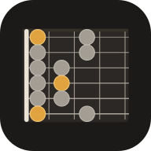
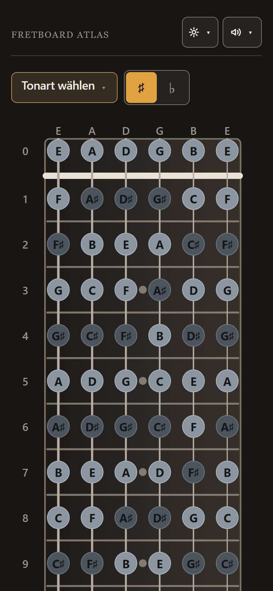
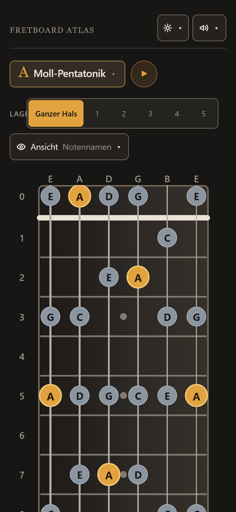
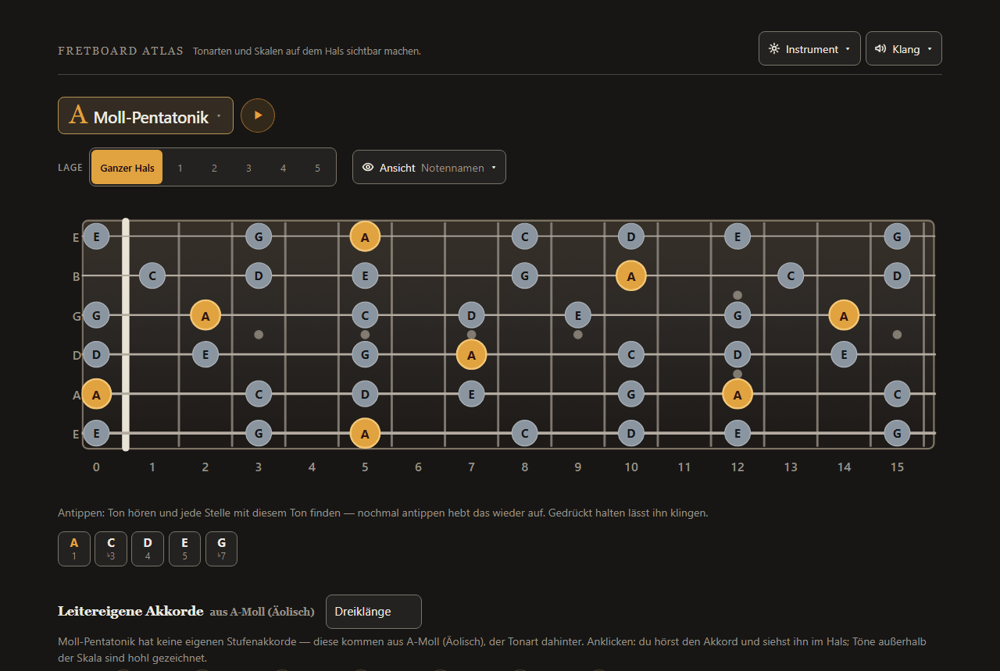

<div align="center">



# Fretboard Atlas

**Tonarten auf dem Gitarrengriffbrett sichtbar machen** – Skalen, Lagen,
leitereigene Akkorde und Griffe. Läuft komplett im Browser, auch offline.

[**▶ App öffnen**](https://jannes105.github.io/Fretboard-Atlas/)

[](https://github.com/Jannes105/Fretboard-Atlas/actions/workflows/deploy.yml)
[](LICENSE)


<br>


&nbsp;&nbsp;


</div>

---

Ein Atlas kartiert und lässt navigieren – genau das tut die App mit dem Hals.
Geöffnet zeigt sie zuerst die Karte selbst: **jeden Ton auf dem Hals**. Mit einer
Tonart kommen Stufen, Lagen, Stufenakkorde und eine abspielbare Akkordfolge dazu.

## Was sie kann

- **Einen Ton finden, indem man ihn antippt.** Er klingt, und jede Stelle mit
  demselben Ton leuchtet auf. Stellen mit *genau derselben Tonhöhe* sind
  zusätzlich umrandet – „dieses C“ ist von „jedem C“ zu unterscheiden.
- **Skalen und Modi** – Dur, Moll, harmonisch und melodisch Moll, alle
  Kirchentonarten, Dur- und Moll-Pentatonik, Bluesskala.
- **Fünf Lagen („Boxen“)** pro Skala, je ein Tipp, dazu CAGED-Formen.
- **Leitereigene Akkorde** mit Griffbildern; Klick spielt den Akkord und zeigt
  ihn auf dem Hals.
- **Akkordfolgen** aus Vorlagen (I–V–vi–IV, ii–V–I, 12-Bar-Blues …) oder eigenen
  Akkorden – die App wählt die Griffe so, dass die Hand möglichst wenig wandert.
- **Abspielen mit echtem Gitarrenklang**: aufgenommene Samples, vier
  Verstärkermodelle, Tonabnehmer, EQ, Hall, Delay, Rhythmus und Schlagmuster.
- **Stimmungen** Standard, Drop D, E♭, D Standard, Drop C oder eigene, mit Kapo.
- **Richtig buchstabiert** – F♯-Dur enthält ein E♯, kein F.
- **Teilen per Link** – die ganze Ansicht steht in der URL.
- **Handy zuerst** – der Hals steht dort senkrecht, alle Bünde untereinander.
  Linkshänder-Modus, hell und dunkel.
- **Installierbar und offline** als PWA – praktisch im Proberaum ohne Netz.

<p align="center">
  
</p>

## Loslegen

Einfach die [App im Browser öffnen](https://jannes105.github.io/Fretboard-Atlas/).
Auf dem Handy lässt sie sich über „Zum Startbildschirm hinzufügen“ wie eine
normale App installieren.

### Lokal entwickeln

Voraussetzung: [Node.js](https://nodejs.org/) 24.

```bash
git clone https://github.com/Jannes105/Fretboard-Atlas.git
cd Fretboard-Atlas
npm install
npm run dev
```

| Befehl | Wirkung |
| --- | --- |
| `npm run dev` | Entwicklungsserver auf <http://localhost:5173> |
| `npm run dev:lan` | zusätzlich im WLAN erreichbar, z. B. fürs Handy |
| `npm test` | alle Tests (Vitest) |
| `npm run lint` | Linter (oxlint) |
| `npm run build` | Typecheck und Produktions-Build nach `dist/` |
| `npm run icons` | PWA-Icons und Favicon aus `icons/build-icons.mjs` neu rendern |

## Technik

React 19 · TypeScript · Vite · Web Audio API · vite-plugin-pwa · Vitest

Kein Backend, keine API, keine Tracker. Die Musiktheorie steckt vollständig in
[`src/theory/`](src/theory) und kennt weder React noch das DOM; der Klang
entsteht in [`src/synth/`](src/synth) aus Web-Audio-Knoten.

Jeder Push auf `main` wird von GitHub Actions getestet, gebaut und auf GitHub
Pages veröffentlicht.

## Dokumentation

| | |
| --- | --- |
| [Architektur und Entscheidungen](docs/architektur.md) | Aufbau des Codes und warum er so ist: Töne als Buchstabe + Vorzeichen, Griffwahl als kürzester Weg, gemessene Verstärker, Zustand in der URL |
| [Recherche-Notizen](docs/README.md) | Musiktheorie, E-Gitarre, Effektpedale, Verstärker – mit Quellen |
| [Feature-Ideen](docs/feature-ideen.md) | Was als Nächstes in Frage kommt |

## Danksagung

Die Gitarrenaufnahmen stammen aus *Shinyguitar* von
[Karoryfer Samples](https://karoryfer.com/) – eine Archtop-Gitarre, gespielt und
gemappt von D. Smolken, veröffentlicht unter [CC0 1.0](https://creativecommons.org/publicdomain/zero/1.0/).
Danke dafür!

## Lizenz

Der Code steht unter der [MIT-Lizenz](LICENSE).
